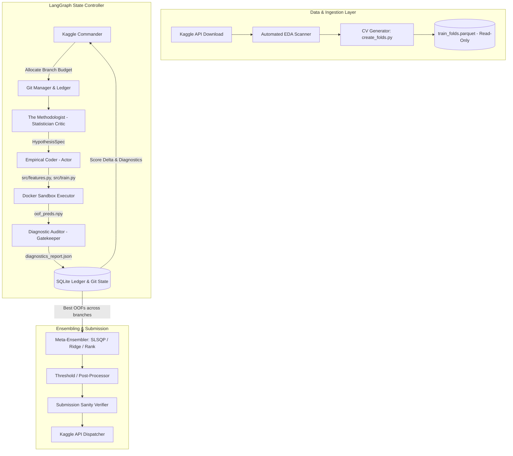

# Multi-Agent Autonomous Kaggle Architecture: Staged Build Master Plan

## 1. System Overview & Core Philosophy

This repository implements a modular, autonomous machine learning system designed to compete in tabular and structured Kaggle competitions (such as the Tabular Playground Series and standard industry prediction tasks). The system models the iterative problem-solving workflow of a competitive data science team through an **Actor-Critic loop**:

- **Execution Agents (Empirical Coders)** write clean, modular feature engineering and modeling scripts.
- **Critic Agents (Methodologists)** reason over formal statistical diagnostics rather than ad-hoc heuristics.
- **Evaluation Gatekeepers (Diagnostic Auditors)** compute leak-free cross-validation scores and token-efficient diagnostic reports.
- **DevOps & Memory Agents** track git provenance, maintain an SQLite anti-amnesia experiment ledger, and manage multi-family branching.
- **Meta-Ensemblers** optimize late-stage predictions across diverse model architectures.



---

## 2. The Four Invariants for True Generalization

1. **Separation of Invariant Process from Domain Content**:
   The cycle (*Ingestion* $\to$ *Leak-Free CV Lock* $\to$ *Multi-Family Exploration* $\to$ *Residual Diagnostics* $\to$ *Theoretical Hypothesis* $\to$ *Git State Gatekeeping* $\to$ *Out-of-Fold Ensembling*) is invariant across all supervised problems. Domain-specific knowledge is learned strictly through automated exploratory data analysis.

2. **Universal Statistical Primitives**:
   Diagnostics are abstracted into standard primitives: residual quantiles, heteroskedasticity correlations, Brier calibration, surrogate error trees, and adversarial validation AUC. The Methodologist reasons over statistical mechanics rather than column names.

3. **Deterministic Ground-Truth Anchoring**:
   Stochastic LLM code generation is constrained by a deterministic Markov Decision Process:
   $$S_{t+1} = \begin{cases} S_t \cup \{\text{Patch}_t\} & \text{if } \mathcal{L}(S_t \cup \{\text{Patch}_t\}) < \mathcal{L}(S_t) - \epsilon \\ S_t & \text{otherwise} \end{cases}$$
   Evaluations are performed exclusively by external, read-only audit scripts.

4. **Anti-Amnesia via the Experiment Ledger**:
   All past hypotheses, code deltas, CV metrics, and failure reasons are logged into an SQLite database (`memory/experiment_ledger.db`) and injected into pre-prompts to prevent cyclical regression.

---

## 3. Staged Implementation Roadmap

The implementation is broken down into five self-contained, verifiable stages. Detailed plans for each stage are provided in the links below:

| Stage | Document | Key Objective | Milestone Verification |
| --- | --- | --- | --- |
| **Stage 1** | [Stage 1: Foundation, Sandbox & Data Contract](file:///Users/kevinwang/projects/automated-kaggle2/plans/stage_1_foundation_sandbox.md) | Kaggle CLI ingestion, immutable CV lock, Docker sandbox runner | CLI ingestion and verified read-only `train_folds.parquet` |
| **Stage 2** | [Stage 2: Diagnostic Auditor & Scoring Harness](file:///Users/kevinwang/projects/automated-kaggle2/plans/stage_2_diagnostic_auditor.md) | Universal metric registry, compact diagnostic generator, adversarial validation | `<1,500`-token `diagnostics_report.json` generated in `<30s` |
| **Stage 3** | [Stage 3: Single-Branch Actor-Critic MVP](file:///Users/kevinwang/projects/automated-kaggle2/plans/stage_3_actor_critic_loop.md) | LangGraph loop with Coder self-healing, Methodologist hypothesis generation | 5-iteration autonomous loop demonstrating CV improvement |
| **Stage 4** | [Stage 4: Memory Ledger & Multi-Family Exploration](file:///Users/kevinwang/projects/automated-kaggle2/plans/stage_4_memory_git_multi_family.md) | Git state machine, SQLite anti-amnesia, 3-iteration incubation grace period | 15-iteration run across 3 model branches with clean rollbacks |
| **Stage 5** | [Stage 5: Ensembling Engine & Autonomous Submission](file:///Users/kevinwang/projects/automated-kaggle2/plans/stage_5_ensembling_submission.md) | SLSQP/Ridge/Rank ensembling, threshold post-processing, automated submission | Dual-competition dry run with ensemble outperforming single best branch |

---

## 4. Master Directory Structure

Once fully deployed, the repository maintains the following layout:

```text
automated-kaggle2/
├── README.md                           # Master Architecture & Guide
├── plans/                              # Detailed Engineering Plans (Stages 1-5)
│   ├── stage_1_foundation_sandbox.md
│   ├── stage_2_diagnostic_auditor.md
│   ├── stage_3_actor_critic_loop.md
│   ├── stage_4_memory_git_multi_family.md
│   └── stage_5_ensembling_submission.md
├── docker/
│   ├── Dockerfile                      # ML execution environment with CUDA/CPU support
│   └── requirements.txt
├── workspace/                          # Competition Execution Root
│   ├── data/                           # Ingestion root (chmod 555 / read-only)
│   │   ├── raw/                        # Original Kaggle competition data
│   │   └── train_folds.parquet         # Immutable 5-fold split (chmod 444)
│   ├── src/                            # Agent-editable scripts
│   │   ├── __init__.py
│   │   ├── features.py                 # Feature engineering pipeline
│   │   └── train.py                    # Training & inference script
│   ├── evaluator/                      # Read-only evaluation harness
│   │   ├── metrics.py                  # Kaggle metric implementations
│   │   ├── diagnostics.py              # Diagnostic summary extractor
│   │   ├── adversarial.py              # Adversarial validation classifier
│   │   └── ensemble.py                 # Meta-ensembling algorithms
│   ├── artifacts/                      # Out-of-fold and test predictions
│   │   ├── oof_preds.npy
│   │   ├── test_preds.npy
│   │   └── registry/                   # Archived branch OOF predictions
│   └── memory/                         # State tracking
│       ├── experiment_ledger.db        # SQLite hypothesis and metric history
│       └── diagnostics_report.json     # Active diagnostic summary
└── orchestrator/                       # Multi-agent controller
    ├── state.py                        # LangGraph state schema & Pydantic models
    ├── llm.py                          # Multi-provider LLM resolver (DeepSeek / Moonshot)
    ├── agents/
    │   ├── commander.py                # High-level budget & family router
    │   ├── coder.py                    # Empirical data scientist code generator
    │   ├── auditor.py                  # Evaluation dispatcher & report compiler
    │   ├── methodologist.py            # Statistical hypothesis generator
    │   └── devops.py                   # Git manager & branch state controller
    ├── graph.py                        # LangGraph compiled state graph
    └── runner.py                       # CLI entry point
```

---

## 5. LLM Provider Hierarchy & Tiering Policy

The orchestrator integrates a multi-provider LLM resolver ([orchestrator/llm.py](file:///Users/kevinwang/projects/automated-kaggle2/orchestrator/llm.py)) that automatically detects API keys from your environment (`~/.zshrc`) with zero manual setup.

### Model Tiering Policy

| Region / Provider | Tier Class | Default Model | Rationale & Capabilities |
| --- | --- | --- | --- |
| **DeepSeek** (`DEEPSEEK_API_KEY`) | **Top-Tier (Default)** | `deepseek/deepseek-chat` (DeepSeek-V3) | Flagship 671B MoE architecture; exceptional statistical reasoning and cost efficiency. Supports `deepseek/deepseek-reasoner` (R1). |
| **Kimi / Moonshot** (`MOONSHOT_API_KEY`) | **Top-Tier Flagship** | `kimi-k3` / `kimi-k2.7-code` | Flagship 2.8T parameter model with 1M-token context window; frontier intelligence in code generation and complex diagnostics. |
| **Google Gemini** (`GEMINI_API_KEY`) | **Mid-Tier Workhorse** | `gemini/gemini-3.8-flash` | Sub-second latency, robust structured JSON output, and multi-modal error slice comprehension. |

### Dynamic CLI Model Override

Override the active LLM on any execution without editing code:

```bash
# Run with default top-tier DeepSeek
python -m orchestrator.runner --competition titanic

# Switch to top-tier Kimi K3
python -m orchestrator.runner --model kimi-k3 --competition titanic

# Switch to mid-tier Gemini 3.8 Flash
python -m orchestrator.runner --model gemini/gemini-3.8-flash --competition titanic
```

### Deterministic Statistical Fallback

If network connectivity is offline or API quotas are exhausted, the Methodologist automatically falls back to the deterministic error-slice deduction engine, ensuring autonomous runs complete without crashing.
