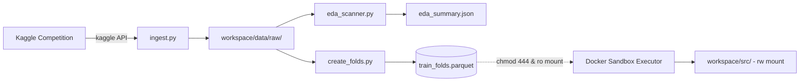

# Stage 1: Foundation, Sandbox & Deterministic Data Contract

## 1. Stage Overview & Architectural Objective

The goal of Stage 1 is to build an uncompromised, leak-free execution and data environment before launching any autonomous LLM agent loops.

In previous autonomous coding setups, LLM agents have exhibited severe failure modes:
1. **Self-Serving Data Splits**: Modifying train/test split seeds or methods inside `train.py` to artificially report higher validation metrics.
2. **Preprocessing Leakage**: Fitting scalers, encoders, or imputation models on the full dataset prior to cross-validation splits.
3. **Environment Pollution / Host Escape**: Leaving orphaned processes, altering system-level files, or exhausting host memory.

Stage 1 resolves these issues by establishing a **hard physical boundary**:
- Raw datasets and cross-validation splits are pre-computed once and mounted as **read-only** (`:ro`).
- Agent-generated code executes inside an isolated Docker container with enforced resource bounds (memory, CPU, GPU, wall-clock timeout).
- Kaggle metadata and an automated Exploratory Data Analysis (EDA) profile are extracted deterministically into structured JSON.



---

## 2. Detailed Task Breakdown

### Task 1.1: Standardized Workspace Template & File Permissions

Create a template workspace directory structure that can be instantiated dynamically for any competition slug.

#### Directory Layout
```text
workspace/
├── data/
│   ├── raw/                        # Extracted Kaggle CSV/parquet files
│   │   ├── train.csv
│   │   ├── test.csv
│   │   └── sample_submission.csv
│   ├── competition_meta.json       # Target column, ID column, evaluation metric, problem type
│   ├── eda_summary.json            # Statistical distribution profile
│   └── train_folds.parquet         # Enforced 5-fold cross-validation split (chmod 444)
├── src/                            # Agent-editable source code (chmod 755)
│   ├── __init__.py
│   ├── features.py                 # Feature engineering functions
│   └── train.py                    # Model training & inference pipeline
├── evaluator/                      # Read-only Auditor scripts (chmod 555)
│   ├── __init__.py
│   ├── metrics.py                  # Immutable competition metric formulas
│   ├── diagnostics.py              # Diagnostic summary extractor
│   └── adversarial.py              # Covariate shift detector
├── artifacts/                      # Execution outputs (chmod 777)
│   ├── oof_preds.npy               # Out-of-fold predictions on train_folds.parquet
│   ├── test_preds.npy              # Predictions on test.csv
│   └── registry/                   # Long-term archived predictions across iterations
└── memory/                         # Agent memory & audit trails
    ├── experiment_ledger.db        # SQLite database tracking iterations
    └── diagnostics_report.json     # Active diagnostic summary (<1,500 tokens)
```

#### File Permission Enforcement
To ensure code agents cannot alter data or metric scoring scripts:
- `workspace/data/` is set to `chmod -R 555` (read + execute only).
- `workspace/data/train_folds.parquet` is set to `chmod 444` (read-only).
- `workspace/evaluator/` is set to `chmod -R 555` (read + execute only).
- Only `workspace/src/`, `workspace/artifacts/`, and `workspace/memory/` remain read-write (`chmod -R 775`).

---

### Task 1.2: Docker Sandbox Runner (`docker/` and `executor/sandbox.py`)

#### Docker Environment (`docker/Dockerfile`)
The Docker container encapsulates a unified tabular machine learning stack:
- **Base**: `python:3.11-slim-bookworm` (with optional CUDA 12.1 runtime for GPU machines).
- **Core ML**: `numpy>=1.26.0`, `scipy>=1.12.0`, `pandas>=2.2.0`, `polars>=0.20.0`, `pyarrow>=15.0.0`
- **Frameworks**: `scikit-learn>=1.4.0`, `lightgbm>=4.3.0`, `xgboost>=2.0.3`, `catboost>=1.2.3`, `torch>=2.2.0`
- **Analysis & Optimization**: `optuna>=3.6.0`, `shap>=0.45.0`
- **System Utilities**: `tini` (init zombie-process reaper), `gfortran`, `build-essential`

#### Dockerfile Specification
```dockerfile
FROM python:3.11-slim-bookworm

ENV DEBIAN_FRONTEND=noninteractive \
    PYTHONUNBUFFERED=1 \
    PYTHONDONTWRITEBYTECODE=1

RUN apt-get update && apt-get install -y --no-install-recommends \
    build-essential \
    libgomp1 \
    git \
    tini \
    && rm -rf /var/lib/apt/lists/*

WORKDIR /app

COPY requirements.txt /app/requirements.txt
RUN pip install --no-cache-dir --upgrade pip && \
    pip install --no-cache-dir -r /app/requirements.txt

ENTRYPOINT ["/usr/bin/tini", "--"]
```

#### Python Executor Interface (`executor/sandbox.py`)
The `DockerExecutor` manages container invocation via `docker-py` or `subprocess`:

```python
from dataclasses import dataclass
from pathlib import Path
import subprocess
from typing import Optional

@dataclass
class ExecutionResult:
    exit_code: int
    stdout: str
    stderr: str
    duration_seconds: float
    oom_killed: bool
    timed_out: bool

class DockerExecutor:
    def __init__(
        self,
        workspace_dir: Path,
        image_name: str = "automated-kaggle-sandbox:latest",
        timeout_seconds: int = 900,       # 15 minutes max per run
        memory_limit: str = "16g",        # Strict memory quota
        cpu_quota: float = 4.0,           # Max 4 CPU cores
        use_gpu: bool = False
    ):
        self.workspace_dir = workspace_dir.resolve()
        self.image_name = image_name
        self.timeout_seconds = timeout_seconds
        self.memory_limit = memory_limit
        self.cpu_quota = cpu_quota
        self.use_gpu = use_gpu

    def run_script(self, script_relative_path: str, args: list[str] = None) -> ExecutionResult:
        """
        Executes a script inside the isolated Docker container.
        Mounting rules:
          workspace/src       -> /app/src       (read-write)
          workspace/data      -> /app/data      (read-only :ro)
          workspace/evaluator -> /app/evaluator (read-only :ro)
          workspace/artifacts -> /app/artifacts (read-write)
        """
        args = args or []
        cmd = [
            "docker", "run", "--rm",
            "--network", "none",                       # Air-gapped: no external requests
            f"--memory={self.memory_limit}",
            f"--cpus={self.cpu_quota}",
            "-v", f"{self.workspace_dir}/src:/app/src:rw",
            "-v", f"{self.workspace_dir}/data:/app/data:ro",
            "-v", f"{self.workspace_dir}/evaluator:/app/evaluator:ro",
            "-v", f"{self.workspace_dir}/artifacts:/app/artifacts:rw",
            "-w", "/app",
            self.image_name,
            "python", script_relative_path, *args
        ]
        if self.use_gpu:
            cmd.insert(3, "--gpus=all")

        try:
            start_time = time.monotonic()
            process = subprocess.run(
                cmd,
                capture_output=True,
                text=True,
                timeout=self.timeout_seconds
            )
            duration = time.monotonic() - start_time
            return ExecutionResult(
                exit_code=process.returncode,
                stdout=process.stdout,
                stderr=process.stderr,
                duration_seconds=duration,
                oom_killed=(process.returncode == 137),
                timed_out=False
            )
        except subprocess.TimeoutExpired as exc:
            return ExecutionResult(
                exit_code=-1,
                stdout=exc.stdout.decode() if exc.stdout else "",
                stderr=exc.stderr.decode() if exc.stderr else "Execution timed out.",
                duration_seconds=float(self.timeout_seconds),
                oom_killed=False,
                timed_out=True
            )
```

---

### Task 1.3: Ingestion Pipeline & Automated EDA (`ingest.py` & `eda_scanner.py`)

#### Competition Ingestion (`ingest.py`)
1. Accepts a competition slug (e.g. `playground-series-s4e10`).
2. Calls the official Kaggle CLI: `kaggle competitions download -c <slug> -p <target_dir>`.
3. Unzips files into `workspace/data/raw/` and inspects directory contents.
4. Auto-detects:
   - **ID Column**: First column matching regex `(?i)(id|row_id|uid|index)`.
   - **Target Column**: Column present in `train.csv` but absent in `test.csv`.
   - **Problem Type**: Analyzed from target uniqueness and dtype:
     - `binary_classification`: Unique values == 2.
     - `multiclass_classification`: Integer/string dtypes with unique values $\in [3, 50]$.
     - `regression`: Continuous float dtypes or unique values $> 50$.
5. Outputs `workspace/data/competition_meta.json`.

#### Automated EDA Profile (`eda_scanner.py`)
Scans `train.csv` and `test.csv` without heavy visualization dependencies and generates `workspace/data/eda_summary.json`:
- **Shapes**: Rows, columns, memory usage.
- **Column Attributes**: Data type (numerical, categorical, timestamp), missing value ratio.
- **Numerical Stats**: Mean, standard deviation, median, IQR, Fisher skewness $\gamma_1$:
  $$\gamma_1 = \frac{\frac{1}{n}\sum_{i=1}^n (x_i - \bar{x})^3}{\left(\frac{1}{n}\sum_{i=1}^n (x_i - \bar{x})^2\right)^{3/2}}$$
- **Categorical Stats**: Unique cardinality, top 5 frequencies, presence of rare categories ($< 1\%$ frequency).
- **Target Metrics**: Class balance distribution or continuous target quantiles (0.01, 0.05, 0.25, 0.5, 0.75, 0.95, 0.99).

```json
{
  "competition_slug": "playground-series-s4e10",
  "problem_type": "binary_classification",
  "id_column": "id",
  "target_column": "loan_status",
  "train_rows": 58645,
  "test_rows": 39098,
  "features": {
    "person_age": {
      "dtype": "int64",
      "missing_ratio": 0.0,
      "skewness": 1.24,
      "min": 20, "max": 144, "median": 26.0
    },
    "loan_intent": {
      "dtype": "object",
      "cardinality": 6,
      "top_categories": {"EDUCATION": 0.23, "MEDICAL": 0.21, "VENTURE": 0.18}
    }
  },
  "target_distribution": {
    "0": 0.789,
    "1": 0.211
  }
}
```

---

### Task 1.4: The Immutable CV Generator (`create_folds.py`)

Cross-validation is the absolute source of truth. To prevent leakage, splits are pre-calculated once and stored with a deterministic `fold` integer column ($0 \le \text{fold} < k$).

#### Stratification and Splitting Logic
1. **Splitting Strategy Selection**:
   - If grouping column specified in metadata: `GroupKFold` ($k = 5$).
   - If time/temporal order detected: `TimeSeriesSplit` ($k = 5$).
   - If classification problem: `StratifiedKFold(n_splits=5, shuffle=True, random_state=42)`.
   - If continuous regression: Quantile-binned StratifiedKFold (binning continuous target into 10 quantiles using `pd.qcut`) to guarantee identical target distributions across all 5 folds.
2. **Output Storage**:
   Writes `workspace/data/train_folds.parquet` containing:
   - All original columns from `train.csv`.
   - One new integer column: `fold` $\in \{0, 1, 2, 3, 4\}$.
3. **Immutability Lock**:
   Executes `os.chmod("workspace/data/train_folds.parquet", 0o444)`. Any subsequent attempt by agent code to overwrite or modify this file results in an OS-level `PermissionError`.

---

## 3. Milestone 1 Verification Criteria

Stage 1 is complete when all of the following commands execute successfully without manual intervention:

```bash
# 1. Download dataset and generate competition metadata
python -m workspace.ingest --competition playground-series-s4e10

# 2. Run automated exploratory data analysis
python -m workspace.eda_scanner --data-dir workspace/data/raw/

# 3. Create immutable fold splits
python -m workspace.create_folds --data-dir workspace/data/raw/ --folds 5

# 4. Verify file immutability
python -c "
import os
try:
    with open('workspace/data/train_folds.parquet', 'a') as f:
        f.write('tamper')
    print('FAIL: train_folds.parquet is writable!')
    exit(1)
except PermissionError:
    print('PASS: train_folds.parquet is read-only (PermissionError caught).')
"

# 5. Verify Docker Sandbox mounting and air-gapping
python -m executor.test_sandbox
```

### Expected Output of Milestone 1
- `workspace/data/raw/train.csv` and `test.csv` exist.
- `workspace/data/competition_meta.json` specifies problem type, target, and ID columns.
- `workspace/data/eda_summary.json` contains full distribution statistics.
- `workspace/data/train_folds.parquet` has an exact 5-way split with identical target distribution across folds.
- Docker sandbox runs Python code, mounts data `:ro`, mounts src `:rw`, and blocks all outbound internet access.
