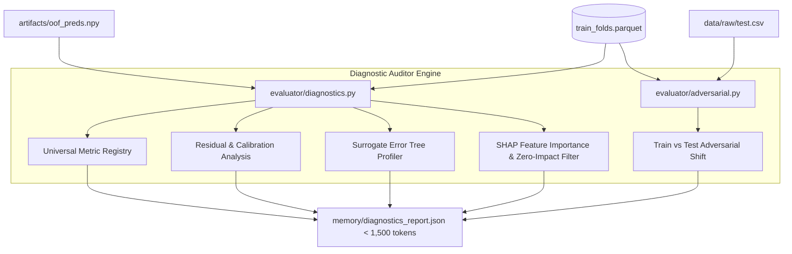

# Stage 2: The Diagnostic Auditor & Scoring Harness

## 1. Stage Overview & Architectural Objective

The Diagnostic Auditor is the mathematical conscience and gatekeeper of the autonomous system. It addresses two critical failure modes in LLM-driven modeling:
1. **Unchecked Metric Hallucination / Self-Scoring**: If an LLM writes the code that evaluates its own model, it can inadvertently compute train scores instead of out-of-fold scores, mask edge-case penalties, or misapply probability thresholds.
2. **Context Window Saturation**: Passing raw tabular data, 50,000-row prediction arrays, multi-megabyte log files, or raw SHAP value matrices directly to an LLM quickly overflows context windows and degrades reasoning capability.

Stage 2 builds a deterministic evaluation engine that:
- Reads out-of-fold predictions (`oof_preds.npy`) produced against the immutable `train_folds.parquet`.
- Computes exact competition metrics across every fold and globally.
- Distills millions of data points into a standardized, token-efficient summary: **`diagnostics_report.json`** ($< 1,500$ tokens).
- Runs adversarial validation to alert the Methodologist to covariate shifts between train and test distributions.



---

## 2. Detailed Task Breakdown

### Task 2.1: Universal Kaggle Metric Registry (`evaluator/metrics.py`)

A pure Python/NumPy/Scikit-learn implementation of standard Kaggle competition metrics. The registry enforces strict handling of NaN values, infinite predictions, and multi-class dimensions.

#### Supported Metrics
- **Regression**:
  - `rmse`: Root Mean Squared Error $\sqrt{\frac{1}{N} \sum (y - \hat{y})^2}$
  - `rmsle`: Root Mean Squared Logarithmic Error $\sqrt{\frac{1}{N} \sum (\ln(1 + y) - \ln(1 + \hat{y}))^2}$ (with automatic zero-clipping $\hat{y} = \max(\hat{y}, 0)$)
  - `mae`: Mean Absolute Error $\frac{1}{N} \sum |y - \hat{y}|$
  - `r2`: Coefficient of Determination
- **Binary Classification**:
  - `roc_auc`: Area Under the ROC Curve
  - `logloss`: Binary Cross-Entropy Loss with probability clipping $[\epsilon, 1-\epsilon]$ ($\epsilon = 10^{-15}$)
  - `f1`: Harmonic mean of precision and recall (with threshold tuning)
  - `mcc`: Matthews Correlation Coefficient
- **Multiclass Classification**:
  - `multi_logloss`: Multi-class cross-entropy
  - `macro_f1`: Macro-averaged F1 score
- **Ordinal / Ranked Regression**:
  - `qwk`: Quadratic Weighted Kappa (common in medical, grading, and discrete ranking competitions):
    $$\kappa = 1 - \frac{\sum_{i,j} w_{i,j} O_{i,j}}{\sum_{i,j} w_{i,j} E_{i,j}}, \quad w_{i,j} = \frac{(i - j)^2}{(C - 1)^2}$$

#### Interface Contract
```python
from typing import Callable, Union
import numpy as np

MetricFunction = Callable[[np.ndarray, np.ndarray], float]

class MetricRegistry:
    @staticmethod
    def get_metric(metric_name: str) -> tuple[MetricFunction, bool]:
        """
        Returns:
            metric_fn: Callable(y_true, y_pred) -> float
            greater_is_better: bool (True for AUC/F1/QWK, False for RMSE/LogLoss)
        """
        registry = {
            "rmse": (MetricRegistry._rmse, False),
            "rmsle": (MetricRegistry._rmsle, False),
            "mae": (MetricRegistry._mae, False),
            "roc_auc": (MetricRegistry._roc_auc, True),
            "logloss": (MetricRegistry._logloss, False),
            "f1": (MetricRegistry._f1, True),
            "mcc": (MetricRegistry._mcc, True),
            "qwk": (MetricRegistry._qwk, True),
        }
        name = metric_name.lower().strip()
        if name not in registry:
            raise ValueError(f"Unsupported metric '{metric_name}'. Registered: {list(registry.keys())}")
        return registry[name]
```

---

### Task 2.2: The Automated Diagnostic Generator (`evaluator/diagnostics.py`)

Takes `train_folds.parquet` and `artifacts/oof_preds.npy` to compute universal statistical primitives.

#### 1. Out-of-Fold Cross-Validation Score & Stability
- Global score: $\mathcal{M}(y_{\text{all}}, \hat{y}_{\text{all}})$
- Fold-by-fold scores: $\mathcal{M}_k(y_k, \hat{y}_k)$ for $k \in \{0, \dots, 4\}$
- Fold standard deviation ($\sigma_{\text{CV}}$):
  $$\sigma_{\text{CV}} = \sqrt{\frac{1}{K-1} \sum_{k=0}^{K-1} (\mathcal{M}_k - \bar{\mathcal{M}})^2}$$
  *Purpose*: Identifies if a model improves global score purely through an outlier fold while destabilizing other folds.

#### 2. Universal Residual & Calibration Mechanics
- **For Continuous Targets (Regression)**:
  - **Residual Skewness**: Quantifies whether errors are asymmetric (under-predicting heavy tails vs. over-predicting).
  - **Heteroskedasticity Correlation**: Pearson correlation between absolute error $|y - \hat{y}|$ and predicted value $\hat{y}$. If $r > 0.3$, error variance scales with prediction magnitude (indicating need for log or Box-Cox target transformations).
  - **Worst Outlier Quantiles**: 95th and 99th percentile of absolute error.
- **For Probabilistic Targets (Classification)**:
  - **Brier Calibration Score**: $\frac{1}{N} \sum (\hat{p}_i - y_i)^2$
  - **Confusion Matrix Balance**: Ratio of False Positives to False Negatives $\frac{FP}{FN}$ at threshold 0.5 (detecting severe decision boundary bias).
  - **Expected Calibration Error (ECE)**: Evaluated across 10 confidence bins.

#### 3. Error Slice Profiling via Surrogate Decision Tree
How do we tell the Methodologist *why* the model is failing without flooding tokens?
- Train a shallow `DecisionTreeRegressor(max_depth=3, min_samples_leaf=50)` where target is the sample-level loss $L_i = |y_i - \hat{y}_i|$.
- Extract the top 3 leaf nodes with highest average error.
- Convert the tree decision paths into plain-language logical rules:
  - Example: `"(person_income <= 32000.0) AND (loan_percent_income > 0.42) -> Mean Absolute Error: 0.81 (Dataset Avg: 0.14)"`
  - This provides the Methodologist with immediate, actionable hypotheses for interaction features.

#### 4. Feature Importance & Zero-Impact Filter
- Fast feature attribution using LightGBM gain or TreeSHAP sampled on 1,000 rows.
- Extract:
  - **Top 15 Most Important Features** (with percentage gain contributions).
  - **Zero-Importance Features**: Features with zero splits or zero SHAP impact across all folds (explicit recommendations for pruning to reduce variance).

---

### Task 2.3: Adversarial Validation Module (`evaluator/adversarial.py`)

A classic Kaggle competitive technique automated for the agent loop:
1. Label all `train.csv` rows as $y_{\text{adv}} = 0$.
2. Label all `test.csv` rows as $y_{\text{adv}} = 1$.
3. Concatenate and drop the competition target column.
4. Train a fast LightGBM binary classifier (5-fold CV, 100 trees, learning rate 0.1).
5. Extract:
   - **Adversarial ROC-AUC**:
     - $\text{AUC} \approx 0.50$: Train and test are identically distributed (IID).
     - $\text{AUC} > 0.70$: Significant covariate shift between train and test.
   - **Top Drifting Features**: The top 3 features the classifier used to distinguish train from test.
   - **Actionable Guidance**: When AUC $> 0.70$, the report instructs the Methodologist to drop or regularize drifting features to prevent private leaderboard shakeup.

---

### Complete Schema: `diagnostics_report.json`

The output file written to `workspace/memory/diagnostics_report.json` must strictly conform to this compact schema ($< 1,500$ tokens):

```json
{
  "iteration": 1,
  "metric_name": "roc_auc",
  "global_cv": 0.8924,
  "fold_scores": [0.8912, 0.8951, 0.8904, 0.8938, 0.8915],
  "fold_std": 0.0017,
  "stability_assessment": "HIGH",
  "residual_analysis": {
    "brier_score": 0.0842,
    "fp_fn_ratio": 1.84,
    "calibration_ece": 0.021
  },
  "error_slices": [
    {
      "condition": "(loan_percent_income > 0.38) & (person_home_ownership == 'RENT')",
      "slice_loss": 0.412,
      "global_loss": 0.108,
      "sample_count": 1420
    },
    {
      "condition": "(loan_intent == 'DEBTCONSOLIDATION') & (person_age < 25)",
      "slice_loss": 0.385,
      "global_loss": 0.108,
      "sample_count": 940
    }
  ],
  "top_features": [
    {"name": "loan_percent_income", "importance": 0.342},
    {"name": "loan_int_rate", "importance": 0.198},
    {"name": "person_income", "importance": 0.145}
  ],
  "zero_importance_features": ["cb_person_default_on_file", "id"],
  "adversarial_validation": {
    "adversarial_auc": 0.512,
    "covariate_shift_detected": false,
    "drifting_features": []
  }
}
```

---

## 3. Milestone 2 Verification Criteria

Stage 2 is verified when:
1. `evaluator/metrics.py` passes all unit tests for metric bounds and edge cases.
2. Dummy prediction inputs run through `evaluator/diagnostics.py` generate `diagnostics_report.json` in $< 30$ seconds.
3. The generated JSON report is measured and confirmed to be under 1,500 tokens.

```bash
# 1. Run unit tests for metric calculations
pytest evaluator/tests/test_metrics.py

# 2. Generate dummy out-of-fold predictions
python -c "
import numpy as np, pyarrow.parquet as pq
table = pq.read_table('workspace/data/train_folds.parquet')
n_rows = table.num_rows
np.save('workspace/artifacts/oof_preds.npy', np.random.uniform(0.1, 0.9, size=n_rows))
"

# 3. Execute diagnostic suite and time it
time python -m workspace.evaluator.diagnostics \
    --folds-path workspace/data/train_folds.parquet \
    --oof-path workspace/artifacts/oof_preds.npy \
    --test-path workspace/data/raw/test.csv \
    --metric roc_auc \
    --output workspace/memory/diagnostics_report.json

# 4. Validate schema and token length
python -c "
import json
with open('workspace/memory/diagnostics_report.json') as f:
    data = json.load(f)
text = json.dumps(data)
approx_tokens = len(text) / 4
print(f'Report Character Count: {len(text)}')
print(f'Estimated Tokens: {approx_tokens:.0f}')
assert approx_tokens < 1500, f'Token count exceeded! {approx_tokens} >= 1500'
assert 'error_slices' in data
assert 'adversarial_validation' in data
print('PASS: Milestone 2 verification successful.')
"
```
