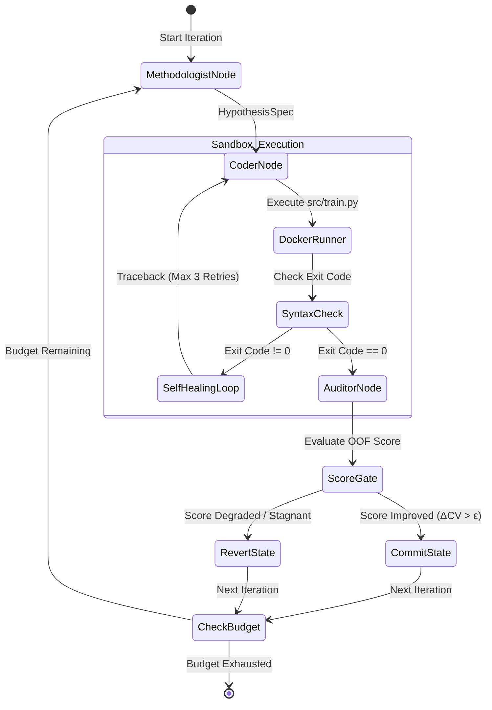

# Stage 3: Single-Branch Actor-Critic MVP (LangGraph State Machine)

## 1. Stage Overview & Architectural Objective

Stage 3 assembles the core autonomous modeling loop: the **Actor-Critic cycle**.
In this stage, we focus on a single model family (e.g., LightGBM) to validate that an execution agent and a reasoning agent can iteratively discover, diagnose, code, and evaluate improvements without human intervention.

### Failure Modes Mitigated in Stage 3
1. **Unconstrained Code Drift**: When an LLM is given blanket permission to rewrite an entire codebase, it often introduces breaking regressions, alters evaluation logic, or drops feature pipelines. In Stage 3, the Empirical Coder is constrained to two modular files:
   - `src/features.py` (stateless feature transformation functions)
   - `src/train.py` (model training and artifact generation)
2. **Infinite Error Loops**: If a generated script has a syntax error or a DataFrame index mismatch, calling the expensive Methodologist agent to re-diagnose is wasteful. We implement an **inner self-healing loop** (up to 3 retries) where the Docker sandbox execution error is fed directly back to the Coder for immediate syntax and runtime repair.
3. **Ungrounded "Vibes-Based" Coding**: The Methodologist is strictly forbidden from writing Python code. Its sole responsibility is statistical deduction: converting the quantitative signals from `diagnostics_report.json` into a formal, falsifiable mathematical hypothesis (`HypothesisSpec`).



---

## 2. Detailed Task Breakdown

### Task 3.1: LangGraph State Schema (`orchestrator/state.py`)

The state schema defines all variables persisted across the graph nodes. We use Python `TypedDict` and Pydantic models for strict type validation.

```python
from typing import Annotated, Any, Literal, Optional, TypedDict
from pydantic import BaseModel, Field

class HypothesisSpec(BaseModel):
    hypothesis_id: str = Field(description="Unique identifier, e.g., hyp_iter_3_ratio_feature")
    statistical_diagnosis: str = Field(
        description="Specific flaw identified in diagnostics_report.json (e.g., error slice in high income, severe skewness in loan amount)"
    )
    intervention_category: Literal["feature_engineering", "target_transform", "hyperparameter", "loss_function"]
    proposed_intervention: str = Field(
        description="Exact mathematical or programmatic specification of the change to implement in features.py or train.py"
    )
    expected_diagnostic_shift: str = Field(
        description="Falsifiable expectation: how residual quantiles, calibration, or fold std should shift if the hypothesis holds"
    )

class AgentState(TypedDict):
    competition_slug: str
    iteration: int
    max_iterations: int
    active_branch: str
    model_family: str                          # e.g., "lightgbm", "catboost"
    best_cv_score: float
    current_cv_score: Optional[float]
    metric_name: str
    greater_is_better: bool
    current_hypothesis: Optional[HypothesisSpec]
    last_diagnostics: Optional[dict[str, Any]]
    execution_error_log: Optional[str]
    retry_count: int
    max_retries: int
    status: Literal["RUNNING", "IMPROVED", "REJECTED", "FAILED", "COMPLETED"]
```

---

### Task 3.2: The Empirical Coder Node & Self-Healing Loop (`orchestrator/agents/coder.py`)

The Empirical Coder receives:
1. The structured `HypothesisSpec` from the Methodologist.
2. The current contents of `src/features.py` and `src/train.py`.
3. The schema and summary from `eda_summary.json`.

#### Prompt Constraints for the Coder
- **Input/Output Contract**:
  - `src/train.py` MUST load data exclusively from `/app/data/train_folds.parquet` and `/app/data/raw/test.csv`.
  - `src/train.py` MUST output `/app/artifacts/oof_preds.npy` and `/app/artifacts/test_preds.npy`.
  - Predictions must match row counts exactly with no NaN or Infinite values.
- **Forbidden Actions**:
  - Never call `train_test_split` or re-split the data.
  - Never compute or print its own private validation score.
  - Never import external AutoML libraries (`auto_gluon`, `flaml`, `tpot`).

#### Inner Self-Healing Loop Algorithm
When `DockerExecutor.run_script("src/train.py")` runs:
1. If `exit_code == 0`: Verify that `artifacts/oof_preds.npy` exists, matches the length of `train_folds.parquet`, and contains no NaNs. If valid, proceed to the Diagnostic Auditor node.
2. If `exit_code != 0` or NaN check fails:
   - Extract the trailing 40 lines of Python `stderr` (traceback).
   - Increment `retry_count`.
   - If `retry_count <= 3`: Invoke the Coder with a targeted repair prompt containing the traceback:
     ```text
     Your previous modification caused the following runtime error:
     {traceback}
     Fix the syntax or dimensional bug in src/features.py or src/train.py without abandoning the core hypothesis.
     ```
   - If `retry_count > 3`: Mark the iteration as `FAILED`, revert changes, and return to the Methodologist for a new hypothesis.

---

### Task 3.3: The Methodologist Node (`orchestrator/agents/methodologist.py`)

The Methodologist is the statistical strategist. It receives:
1. `workspace/memory/diagnostics_report.json` (compact error report from Stage 2).
2. The previous hypothesis and its empirical score delta ($\Delta \text{CV}$).
3. A summary of past rejected and accepted interventions (preventing loops).

#### Methodologist System Prompt Architecture
```text
You are the Lead Methodologist for an autonomous competitive machine learning system.
You do NOT write Python code. You formulate mathematically grounded, falsifiable hypotheses.

Your inputs:
1. `diagnostics_report.json`: Contains CV metrics, fold stability, residual skewness, error slice rules, and SHAP importances.
2. `eda_summary.json`: Column distributions, missingness, and cardinality.
3. `experiment_history`: Past attempts and outcomes.

Your task:
Analyze the error slices and residual anomalies. Propose ONE clean, focused intervention to improve the out-of-fold score.

Rules:
- If error slices indicate high loss in a specific combination of features, propose an interaction feature (ratio, product, group aggregation).
- If residual skewness or heteroskedasticity is high, propose a target transformation (log1p, Yeo-Johnson) or an asymmetric loss function.
- If adversarial validation AUC > 0.70, identify drifting features and propose dropping or regularizing them.
- Output your reasoning strictly conforming to the `HypothesisSpec` Pydantic schema.
```

#### LLM Provider Hierarchy & Resolver (`orchestrator/llm.py`)
To prevent vendor lock-in and enable flexible multi-provider switching across diverse API keys:
1. **Default Provider (`DEEPSEEK_API_KEY`)**: Defaults to `deepseek/deepseek-chat` via LiteLLM using keys exported in shell profiles (`~/.zshrc`).
2. **Secondary Provider (`MOONSHOT_API_KEY`)**: Configured for seamless switching to Moonshot models (`moonshot/moonshot-v1-8k` or `moonshot/moonshot-v1-32k`).
3. **Enterprise & Third-Party Fallbacks**: Automatically detects `OPENAI_API_KEY`, `ANTHROPIC_API_KEY`, or `GEMINI_API_KEY` if present.
4. **CLI Model Override**: The runner CLI accepts `--model <model_name>` to override the active LLM on demand without code changes:
   ```bash
   python -m orchestrator.runner --model moonshot/moonshot-v1-8k --competition titanic
   ```
5. **Deterministic Statistical Fallback**: If network calls or API limits fail, the Methodologist automatically falls back to the deterministic error-slice deduction engine so autonomous runs never crash.

---

### Task 3.4: LangGraph Assembly & State Machine (`orchestrator/graph.py`)

Using LangGraph, the nodes and edges are wired into an executable state graph:

```python
from langgraph.graph import StateGraph, END
from orchestrator.state import AgentState
from orchestrator.agents.methodologist import methodologist_node
from orchestrator.agents.coder import coder_node
from orchestrator.agents.auditor import auditor_node
from orchestrator.agents.devops import devops_gate_node

def should_retry(state: AgentState) -> str:
    if state["execution_error_log"] and state["retry_count"] <= state["max_retries"]:
        return "coder_retry"
    elif state["execution_error_log"]:
        return "devops_revert"
    return "auditor_eval"

def check_budget(state: AgentState) -> str:
    if state["iteration"] >= state["max_iterations"]:
        return END
    return "methodologist_node"

def build_single_branch_graph():
    builder = StateGraph(AgentState)

    builder.add_node("methodologist_node", methodologist_node)
    builder.add_node("coder_node", coder_node)
    builder.add_node("auditor_node", auditor_node)
    builder.add_node("devops_gate_node", devops_gate_node)

    builder.set_entry_point("methodologist_node")

    builder.add_edge("methodologist_node", "coder_node")
    
    # Conditional edge for self-healing
    builder.add_conditional_edges(
        "coder_node",
        should_retry,
        {
            "coder_retry": "coder_node",
            "devops_revert": "devops_gate_node",
            "auditor_eval": "auditor_node"
        }
    )

    builder.add_edge("auditor_node", "devops_gate_node")

    # Conditional edge for loop termination
    builder.add_conditional_edges(
        "devops_gate_node",
        check_budget,
        {
            "methodologist_node": "methodologist_node",
            END: END
        }
    )

    return builder.compile()
```

---

## 3. Milestone 3 Verification Criteria

Stage 3 is verified through an autonomous 5-iteration dry run on a live tabular dataset (e.g., Kaggle Playground Series S4E10: Loan Approval Prediction):

### Test Execution Command
```bash
python -m orchestrator.runner \
    --competition playground-series-s4e10 \
    --model-family lightgbm \
    --max-iterations 5 \
    --epsilon 0.0005
```

### Success Verification Assertions
1. **Autonomous Initialization**: Iteration 0 writes `src/features.py` and `src/train.py`, successfully producing `artifacts/oof_preds.npy`.
2. **Self-Healing Tested**: Inject a synthetic syntax error into `features.py` and verify that the Coder detects the traceback and heals itself within 2 retries without crashing the graph.
3. **Structured Hypotheses**: Verify that the Methodologist outputs a valid `HypothesisSpec` for every iteration that directly references items from `diagnostics_report.json`.
4. **Deterministic Gatekeeping**: If an iteration degrades CV, verify that changes are rejected and the state resets to the previous best code.
5. **Score Improvement**: Over 5 iterations, the best CV metric demonstrates a measurable improvement ($\Delta \text{CV} > 0.001$) over the raw baseline.
