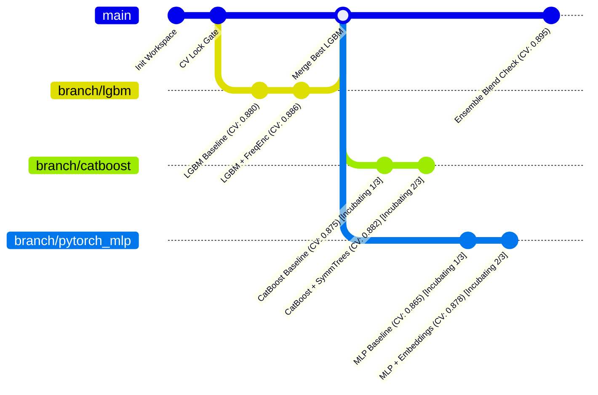

# Stage 4: Memory Ledger, Git State Machine & Multi-Family Exploration

## 1. Stage Overview & Architectural Objective

Single-branch hill-climbing inevitably falls into the **AutoML Local Minimum Trap**:
- An agent optimizes a single tree algorithm (e.g. LightGBM) for 10 iterations.
- When it attempts a fundamentally different architecture (e.g., PyTorch Neural Net or CatBoost with target encoding), the raw, un-tuned iteration of the new family will almost certainly score lower than the mature baseline.
- Under greedy single-branch gating, the new architecture is immediately rejected, trapping the system in a single-model local minimum.

Stage 4 expands the single-branch loop into a **multi-family state machine** supported by:
1. **Model-Family Git Branches**: Distinct branches (`branch/lgbm`, `branch/catboost`, `branch/xgb`, `branch/pytorch_mlp`) maintaining isolated code lineages.
2. **The 3-Iteration Incubation Rule**: A newly spawned model family is granted a 3-iteration local grace period where it is judged solely against its own family baseline, allowing it to mature before competing globally.
3. **Diversity Acceptance Rule**: A branch is accepted if its out-of-fold error correlation with the main branch is sufficiently low ($\rho < 0.85$) and it improves the multi-model ensemble blend, even if its solo CV score is slightly lower than the single best model.
4. **Anti-Amnesia SQLite Ledger**: Persistent logging of all hypotheses, diff summaries, and quantitative outcomes injected into pre-prompts to eliminate repetitive or circular exploration.



---

## 2. Detailed Task Breakdown

### Task 4.1: SQLite Experiment Ledger (`memory/ledger.py`)

The Experiment Ledger is the long-term memory system that prevents circular reasoning across extended runs (30–100 iterations).

#### SQLite Schema Specification
```sql
CREATE TABLE IF NOT EXISTS experiments (
    id INTEGER PRIMARY KEY AUTOINCREMENT,
    timestamp DATETIME DEFAULT CURRENT_TIMESTAMP,
    iteration INTEGER NOT NULL,
    branch_name TEXT NOT NULL,
    model_family TEXT NOT NULL,
    parent_commit TEXT NOT NULL,
    commit_hash TEXT,
    hypothesis_id TEXT NOT NULL,
    hypothesis_summary TEXT NOT NULL,
    intervention_category TEXT NOT NULL,
    files_modified TEXT NOT NULL,          -- JSON list, e.g. ["src/features.py"]
    code_diff_summary TEXT,                -- Unified diff summary of changes
    cv_score REAL,
    cv_std REAL,
    score_delta REAL,                      -- ΔCV compared to branch baseline
    oof_correlation_with_best REAL,        -- Pearson correlation with main best OOF
    ensemble_contribution REAL,            -- Weight in Ridge/SLSQP ensemble
    status TEXT NOT NULL CHECK(status IN ('ACCEPTED', 'REJECTED', 'INCUBATING', 'CRASHED')),
    failure_reason TEXT
);

CREATE INDEX IF NOT EXISTS idx_branch ON experiments(branch_name);
CREATE INDEX IF NOT EXISTS idx_status ON experiments(status);
```

#### Pre-Prompt Anti-Amnesia Summarizer
Before the Methodologist formulates a hypothesis for iteration $N$, `ledger.py` queries the database and formats an injected prompt block:

```python
def format_anti_amnesia_context(branch_name: str, last_n: int = 10) -> str:
    """
    Extracts past successful and failed interventions to prevent repetitive suggestions.
    """
    # Queries SQLite for the last_n experiments on this branch and across other branches
    summary = ["### Past Experiment Ledger (Anti-Amnesia):"]
    summary.append("#### Proven Successful Interventions:")
    # e.g., "- Iteration 2: Target encoding on 'loan_intent' (+0.0041 AUC)"
    summary.append("#### Explicitly Failed / Regressed Interventions (DO NOT REPEAT):")
    # e.g., "- Iteration 4: Polynomial degree-3 expansion on 'person_income' (-0.0082 AUC, high variance)"
    return "\n".join(summary)
```

---

### Task 4.2: Git Branch Controller (`devops/git_manager.py`)

A programmatic Git wrapper built on Python `subprocess` to manage code provenance and rollbacks.

#### Core State Transitions & Operations
1. **Branch Initialization**:
   - Creates and tracks dedicated branches: `branch/lgbm`, `branch/catboost`, `branch/xgb`, `branch/pytorch_mlp`.
2. **Atomic Commits**:
   - When an iteration passes validation, commits code with a standardized message:
     `git commit -m "[ACCEPTED] Iter {N} ({model_family}): {hypothesis_id} | CV: {score:.5f} (Δ: {delta:+.5f})"`
3. **Hard Rollback on Degradation**:
   - If $\Delta \text{CV} \le 0$ (or non-improving during standard hill-climbing), executes:
     `git reset --hard HEAD` and restores the last accepted commit state.
4. **Incubation Grace Period**:
   - Maintains an iteration counter per branch.
   - For iterations $\le 3$ on a new branch:
     - Compare CV only against the *branch's own initial commit*.
     - Allow progression even if lower than global `main`.
     - Tags status as `INCUBATING`.

```python
import subprocess
from pathlib import Path

class GitManager:
    def __init__(self, repo_dir: Path):
        self.repo_dir = repo_dir

    def _run(self, cmd: list[str]) -> str:
        res = subprocess.run(
            cmd, cwd=self.repo_dir, capture_output=True, text=True, check=True
        )
        return res.stdout.strip()

    def checkout_branch(self, branch_name: str, create: bool = False):
        if create:
            self._run(["git", "checkout", "-b", branch_name])
        else:
            self._run(["git", "checkout", branch_name])

    def commit_iteration(self, message: str) -> str:
        self._run(["git", "add", "src/features.py", "src/train.py"])
        self._run(["git", "commit", "-m", message])
        return self._run(["git", "rev-parse", "HEAD"])

    def hard_rollback(self):
        """Rolls back any uncommitted or degrading modifications."""
        self._run(["git", "reset", "--hard", "HEAD"])
        self._run(["git", "clean", "-fd", "src/"])
```

---

### Task 4.3: OOF Prediction Archiving & Diversity Check

Individual models with identical error profiles are redundant. Real ensemble power comes from **error diversity**.

#### Archival Storage Contract
Whenever an iteration is accepted:
1. `artifacts/oof_preds.npy` is copied to:
   `workspace/artifacts/registry/{model_family}_{commit_hash[:7]}_oof.npy`
2. `artifacts/test_preds.npy` is copied to:
   `workspace/artifacts/registry/{model_family}_{commit_hash[:7]}_test.npy`

#### Diversity Metric: Error Correlation Matrix
For all predictions in `artifacts/registry/`:
1. Load $M$ prediction vectors: $P = [\hat{y}_1, \hat{y}_2, \dots, \hat{y}_M]$.
2. Compute the Pearson error correlation matrix:
   $$\rho_{i,j} = \text{Corr}(e_i, e_j) = \text{Corr}(y - \hat{y}_i, y - \hat{y}_j)$$
3. **The Diversity Acceptance Rule**:
   If an incubating model family finishes its 3-iteration sprint and has $\rho < 0.85$ relative to the best GBDT model, evaluate a fast linear blend:
   $$\hat{y}_{\text{blend}} = w \hat{y}_{\text{best}} + (1 - w) \hat{y}_{\text{new}}, \quad w \in [0, 1]$$
   If $\mathcal{M}(\hat{y}_{\text{blend}}) > \mathcal{M}(\hat{y}_{\text{best}})$, the branch is declared **ACCEPTED into the Ensemble Registry**, even if $\mathcal{M}(\hat{y}_{\text{new}}) < \mathcal{M}(\hat{y}_{\text{best}})$.

---

## 3. Milestone 4 Verification Criteria

Stage 4 is verified through a 15-iteration multi-branch test across 3 model families (LightGBM, CatBoost, and PyTorch MLP):

### Test Execution Command
```bash
python -m orchestrator.runner \
    --competition playground-series-s4e10 \
    --multi-family \
    --branches lgbm,catboost,pytorch_mlp \
    --iterations-per-branch 5
```

### Verification Checklist
1. **Branch Isolation**: Verify in `git branch` that branches `branch/lgbm`, `branch/catboost`, and `branch/pytorch_mlp` exist and have independent commit logs.
2. **Rollback Accuracy**: Verify that when a synthetic negative hypothesis is tested on `branch/catboost`, the Git manager cleanly issues `git reset --hard` and restores the file system.
3. **Ledger Integrity**:
   ```bash
   sqlite3 workspace/memory/experiment_ledger.db "SELECT id, branch_name, model_family, cv_score, status FROM experiments;"
   ```
   Confirm that all 15 iterations are logged with correct statuses (`ACCEPTED`, `REJECTED`, `INCUBATING`).
4. **Registry Population**:
   Verify that `workspace/artifacts/registry/` contains distinct, uncorrupted `.npy` files for all surviving branches.
5. **Diversity Matrix**:
   Run `python -m workspace.evaluator.diversity_check` and confirm that cross-model error correlation $\rho$ is calculated and reported in standard output.
