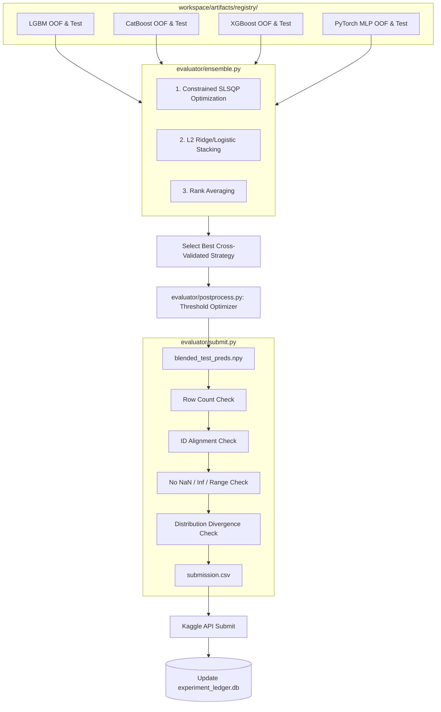

# Stage 5: The Ensembling Engine & Autonomous Submission

## 1. Stage Overview & Architectural Objective

The endgame of any competitive Kaggle solution is ensembling and post-processing.
Even the best single model family (e.g. tuned LightGBM) leaves systematic variance on the table that can be cancelled out by blending orthogonal predictions from CatBoost, XGBoost, and PyTorch Neural Networks.

Stage 5 completes the autonomous system by implementing:
1. **The Out-of-Fold (OOF) Meta-Ensembler**: A deterministic ensembling engine that loads predictions across all surviving model-family branches and determines optimal blending weights via three mathematical strategies (Constrained SLSQP Optimization, L2 Regularized Stacking, and Rank Averaging).
2. **The Post-Processing & Threshold Optimizer**: Tuning metric-specific cutoffs (e.g., Nelder-Mead simplex search for F1 or Quadratic Weighted Kappa thresholds) strictly on out-of-fold predictions.
3. **The Submission Sanity Gate**: Pre-submission automated verification checking row counts, column alignment, ID preservation, NaN/Inf checks, and distribution drift against the training target.
4. **Kaggle API Dispatcher**: Automated submission dispatching with code provenance tags, tracking the public leaderboard score directly back into the SQLite ledger.



---

## 2. Detailed Task Breakdown

### Task 5.1: Out-of-Fold (OOF) Meta-Ensembler (`evaluator/ensemble.py`)

The meta-ensembler loads all accepted out-of-fold prediction vectors stored in `artifacts/registry/` and stacks them into matrices:
- $P_{\text{OOF}} \in \mathbb{R}^{N \times M}$ (where $N$ is the number of training samples, $M$ is the number of models).
- $P_{\text{test}} \in \mathbb{R}^{T \times M}$ (where $T$ is the number of test samples).
- Ground truth target vector $y \in \mathbb{R}^N$ from `train_folds.parquet`.

#### Ensembling Strategy 1: Constrained Optimization (SLSQP)
Finds a convex combination of model weights:
$$\min_{\mathbf{w}} \mathcal{L}\left(y, \sum_{m=1}^M w_m P_{\text{OOF}}^{(m)}\right) \quad \text{subject to } \sum_{m=1}^M w_m = 1, \quad w_m \ge 0$$
- Solved using `scipy.optimize.minimize(method='SLSQP')`.
- For bounded probabilities, applies sigmoid/softmax transforms if optimizing log-loss.
- Applies the optimal weight vector $\mathbf{w}^*$ directly to test predictions:
  $$\hat{y}_{\text{test}} = \sum_{m=1}^M w_m^* P_{\text{test}}^{(m)}$$

#### Ensembling Strategy 2: L2-Regularized Stacking (Ridge / Logistic)
When $M \ge 5$, simple weighting can overfit the OOF predictions. We implement 5-fold cross-validated stacking:
- For regression: `RidgeCV(alphas=np.logspace(-3, 3, 20), cv=5)`
- For classification: `LogisticRegressionCV(Cs=20, cv=5, penalty='l2')`
- Meta-features can optionally include first-order interaction features ($P_i \times P_j$) if $M \le 4$.

#### Ensembling Strategy 3: Rank Averaging
Critical for rank-dependent metrics (such as ROC-AUC, PR-AUC, or Spearman correlation) where different models output poorly calibrated raw probability ranges:
1. Replace predictions of each model with their empirical percentile ranks:
   $$R^{(m)}_i = \frac{\text{rank}(P_i^{(m)}) - 1}{N - 1} \in [0, 1]$$
2. Average the ranks across models:
   $$\hat{y}_{\text{rank}} = \frac{1}{M} \sum_{m=1}^M R^{(m)}$$

#### Selection Gate
The meta-ensembler evaluates all three strategies using the exact competition metric from `evaluator/metrics.py`. The strategy with the highest out-of-fold score is selected for final submission.

---

### Task 5.2: Post-Processing & Threshold Optimizer (`evaluator/postprocess.py`)

Raw model outputs often assume a default 0.5 decision threshold or continuous outputs when the evaluation metric rewards discrete optimization.

#### Optimization Algorithms
1. **F1 / MCC Threshold Search**:
   - For binary classification, use golden section search (`scipy.optimize.minimize_scalar`) to find the threshold $\tau^* \in [0.1, 0.9]$ that maximizes $F_1(y, \mathbb{I}\{\hat{p} > \tau\})$.
2. **Quadratic Weighted Kappa (QWK) Cutoff Optimization**:
   - For ordinal targets with $K$ classes, continuous regression predictions $\hat{y}$ require $K-1$ boundary thresholds:
     $$\mathbf{t} = [t_1, t_2, \dots, t_{K-1}], \quad t_1 < t_2 < \dots < t_{K-1}$$
   - Solved using the Nelder-Mead simplex algorithm initialized at empirical target quantiles:
     $$\max_{\mathbf{t}} \text{QWK}\left(y, \text{digitize}(\hat{y}, \mathbf{t})\right)$$
3. **Probability Calibration**:
   - Isotonic Regression (`sklearn.isotonic.IsotonicRegression`) or Platt Scaling (`CalibratedClassifierCV`) fitted out-of-fold to align predicted probabilities with actual event rates.

---

### Task 5.3: Pre-Submission Sanity Gate & Kaggle Dispatcher (`evaluator/submit.py`)

Before calling the Kaggle CLI, the submission file must pass through a strict, multi-stage sanity barrier:

```python
import pandas as pd
import numpy as np
from pathlib import Path

class SubmissionVerifier:
    @staticmethod
    def verify_and_save(
        preds: np.ndarray,
        sample_sub_path: Path,
        output_path: Path,
        problem_type: str,
        train_target_sample: np.ndarray
    ) -> bool:
        """
        Validates predictions against sample_submission.csv contracts.
        Raises ValueError if any assertion fails.
        """
        sample_sub = pd.read_csv(sample_sub_path)
        id_col = sample_sub.columns[0]
        target_col = sample_sub.columns[1]

        # 1. Dimensionality checks
        if len(preds) != len(sample_sub):
            raise ValueError(f"Row count mismatch! Preds: {len(preds)}, Expected: {len(sample_sub)}")

        # 2. Value validity checks
        if np.isnan(preds).any():
            raise ValueError("Submission contains NaN values!")
        if np.isinf(preds).any():
            raise ValueError("Submission contains Infinite values!")

        # 3. Probability bounds check
        if problem_type in ("binary_classification", "multiclass_classification"):
            if (preds < -1e-5).any() or (preds > 1.0 + 1e-5).any():
                raise ValueError("Classification probabilities out of [0, 1] bounds!")
            preds = np.clip(preds, 0.0, 1.0)

        # 4. Distribution sanity check (Wasserstein / KS-test divergence)
        # Prevents submitting inverted or zero-variance collapsed predictions
        pred_std = np.std(preds)
        if pred_std < 1e-6:
            raise ValueError("Prediction variance is zero! Model collapsed to constant value.")

        # 5. Format output
        sub_df = pd.DataFrame({
            id_col: sample_sub[id_col],
            target_col: preds
        })
        sub_df.to_csv(output_path, index=False)
        print(f"Sanity verification passed. Submission saved to {output_path}")
        return True
```

#### Automated Kaggle Dispatcher
When verification passes:
1. Compute the active git commit hash: `git rev-parse --short HEAD`.
2. Construct a descriptive submission message:
   `"[Git: {commit_hash}] Ensemble Blend (CV: {ensemble_cv:.5f}) | Models: {model_list}"`
3. Execute Kaggle CLI:
   ```bash
   kaggle competitions submit -c {competition_slug} -f workspace/artifacts/submission.csv -m "{message}"
   ```
4. Query the leaderboard score after 60 seconds:
   ```bash
   kaggle competitions submissions -c {competition_slug}
   ```
5. Update `workspace/memory/experiment_ledger.db` with the public score.

---

## 3. Milestone 5 Verification: End-to-End Dry Run

Stage 5 is verified through complete, autonomous runs on two distinct historical competitions:

### Test Competitions
1. **Regression Benchmark**: Kaggle Playground Series S4E9 (Used Car Price Prediction) - Target: continuous regression (`rmse`).
2. **Binary Classification Benchmark**: Kaggle Playground Series S4E10 (Loan Approval Prediction) - Target: binary probability (`roc_auc`).

### Execution Command
```bash
# Full end-to-end autonomous dry run
python -m orchestrator.runner \
    --competition playground-series-s4e10 \
    --full-pipeline \
    --branches lgbm,catboost,xgb,pytorch_mlp \
    --max-iterations 25 \
    --enable-ensemble \
    --auto-submit
```

### Milestone 5 Success Criteria
1. **Ensemble Superiority**: The final cross-validated ensemble score ($\mathcal{M}_{\text{ensemble}}$) must strictly outperform every individual model family's single best score:
   $$\mathcal{M}_{\text{ensemble}} > \max\left(\mathcal{M}_{\text{lgbm}}, \mathcal{M}_{\text{catboost}}, \mathcal{M}_{\text{xgb}}, \mathcal{M}_{\text{pytorch}}\right)$$
2. **Threshold Optimization Gain**: Post-processed thresholding yields a positive metric delta over uncalibrated predictions.
3. **Flawless Submission Validation**: `workspace/artifacts/submission.csv` matches `sample_submission.csv` in line count, column names, and row ordering.
4. **End-to-End Autonomy**: Entire 25-iteration run completes from download to final submission without a single human keystroke or manual intervention.
